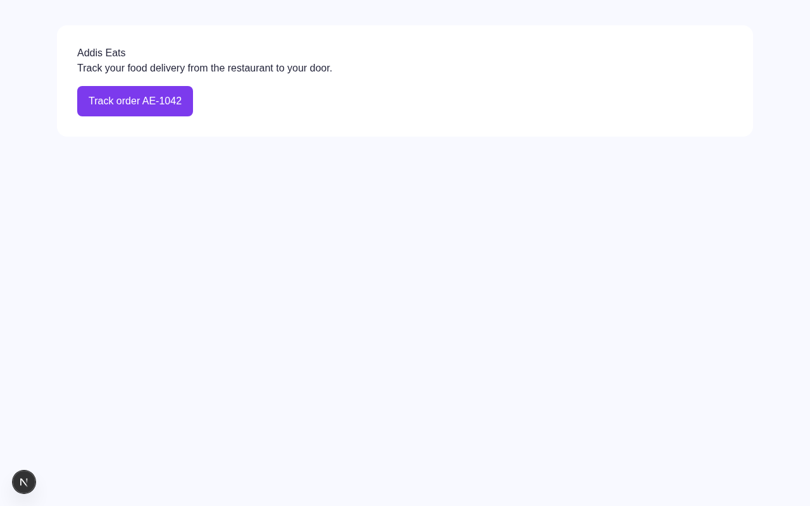
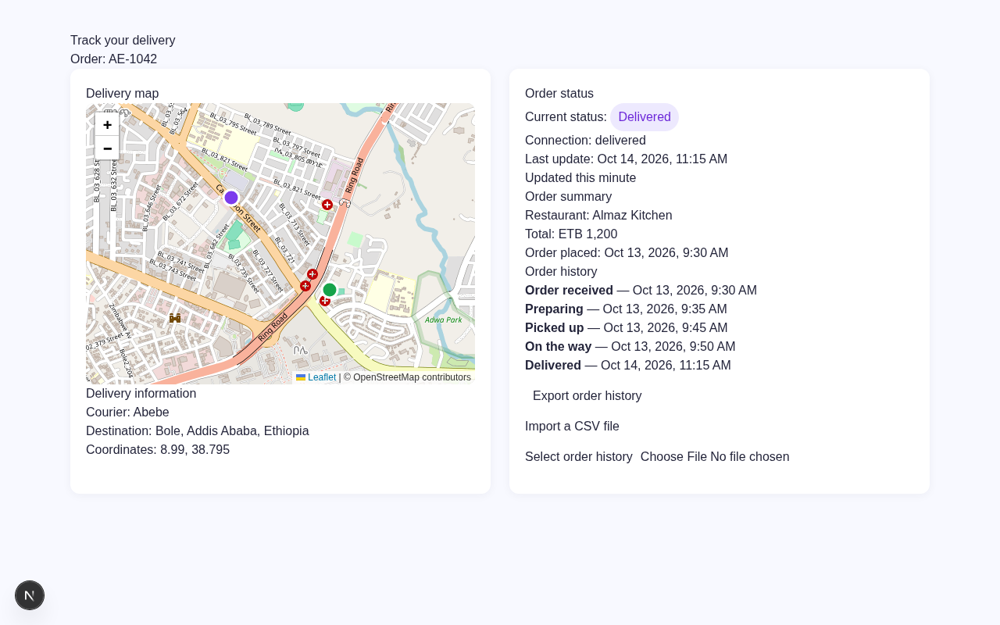

# Addis Eats Tracking — DAY 47

A Next.js delivery tracking application built for **Module 3, Day 47** of the IBTC React & Next.js course.

Covers four topics in one working app: **interactive maps**, **real-time data via SSE**, **Ethiopian locale formatting**, and **CSV file export/import**.

---

## Screenshots

### Home Page



### Delivery Tracking Page



---

## What It Does

| Feature | Detail |
|---|---|
| Interactive map | Leaflet + React Leaflet, courier (purple) and destination (green) markers, auto-fitted bounds |
| Real-time status | Server-Sent Events stream cycling `Preparing → Picked up → On the way → Delivered` every 5 s |
| Ethiopian formatting | ETB currency, `Africa/Addis_Ababa` timezone, relative time via `Intl` APIs |
| CSV export | Proper quoting, formula-injection protection, UTF-8 BOM for Excel compatibility |
| CSV upload | Client-side validation — 2 MB size limit, `.csv` extension check |

---

## Project Structure

```
addis-eats-tracking/
├── app/
│   ├── layout.js                      # Root layout + metadata
│   ├── page.js                        # Home page → links to /track/AE-1042
│   ├── globals.css                    # Tailwind + custom styles
│   ├── not-found.js                   # 404 page
│   ├── track/[id]/
│   │   ├── page.js                    # Server component — loads order, guards 404
│   │   ├── TrackingClient.js          # Client component — SSE, map, history, export
│   │   ├── MapPanel.js                # Dynamic import wrapper (ssr: false)
│   │   └── DeliveryMap.js             # Leaflet map with markers
│   └── api/orders/[id]/stream/
│       └── route.js                   # SSE route handler (Node.js runtime)
├── lib/
│   ├── orders.js                      # demoOrder data (AE-1042)
│   ├── format.js                      # etb · when · relative formatters
│   └── csv.js                         # toCsv · downloadCsv
└── public/
    └── screenshots/
        ├── home.png
        └── tracking.png
```

---

## Getting Started

```bash
npm install
npm run dev
```

Open [http://localhost:3000](http://localhost:3000) and click **Track order AE-1042**.

---

## Key Concepts

### 1 — Maps with Leaflet

Leaflet requires browser APIs (`window`, DOM) that the Next.js server does not have.  
The map is loaded with `dynamic(() => import('./DeliveryMap'), { ssr: false })` inside a Client Component (`MapPanel.js`).  
`ssr: false` must be set inside a Client Component — it cannot be used directly in a Server Component.

Coordinate order in Leaflet is **`[latitude, longitude]`** — the opposite of GeoJSON.

### 2 — Server-Sent Events (SSE)

`route.js` returns a `ReadableStream` with `Content-Type: text/event-stream`.  
Each message ends with `\n\n` — the blank line is required by the SSE protocol.  
`TrackingClient.js` opens an `EventSource`, parses each JSON payload, and updates state.  
The connection is closed when the order reaches `Delivered` or the component unmounts.

### 3 — Ethiopian Locale Formatting

```js
// Currency
const etb = new Intl.NumberFormat('en-ET', { style: 'currency', currency: 'ETB', maximumFractionDigits: 0 });
etb.format(1200); // ETB 1,200

// Date + time in Addis Ababa (UTC+3, year-round)
const when = new Intl.DateTimeFormat('en-ET', { dateStyle: 'medium', timeStyle: 'short', timeZone: 'Africa/Addis_Ababa' });

// Relative time
const rtf = new Intl.RelativeTimeFormat('en', { numeric: 'auto' });
rtf.format(-12, 'minute'); // "12 minutes ago"
```

Always store timestamps as UTC (`Z` suffix) and convert at the display boundary.

### 4 — CSV Export

Fields containing commas, quotes, or newlines are wrapped in double-quotes.  
Internal double-quotes are escaped by doubling them (`"` → `""`).  
Values starting with `=`, `+`, `-`, or `@` are prefixed with `'` to prevent spreadsheet formula injection.  
A UTF-8 BOM (`\uFEFF`) is prepended so Excel opens the file with correct encoding.

---

## Demo Order

```
Order ID   : AE-1042
Restaurant : Almaz Kitchen · Bole, Addis Ababa
Total      : ETB 1,200
Courier    : Abebe  (8.9950, 38.7896)
Destination: Bole   (8.9900, 38.7950)
```

---

## Tech Stack

- [Next.js 15](https://nextjs.org/) — App Router, Server Components, Route Handlers
- [React 19](https://react.dev/)
- [Leaflet](https://leafletjs.com/) + [React Leaflet](https://react-leaflet.js.org/)
- [Tailwind CSS v4](https://tailwindcss.com/)
- Browser-native `Intl` APIs — no extra i18n dependency
