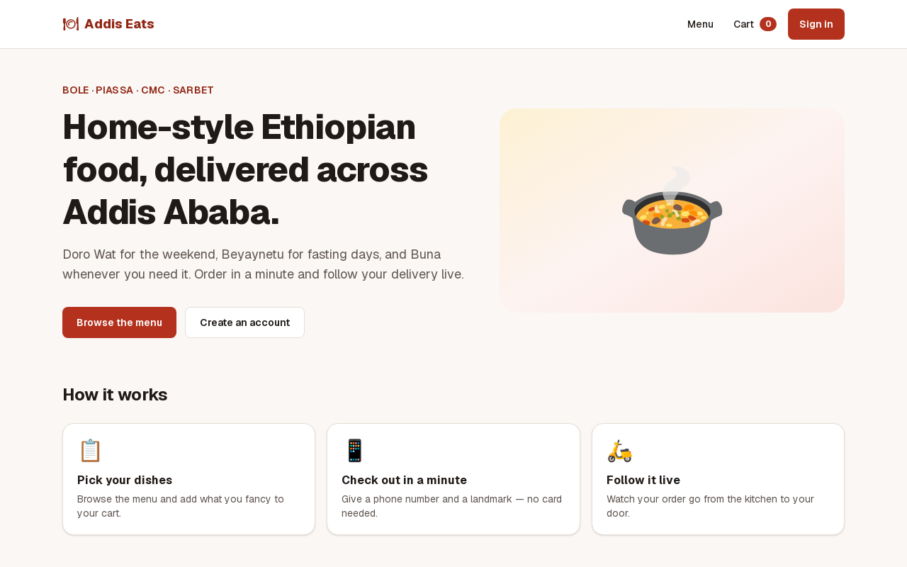
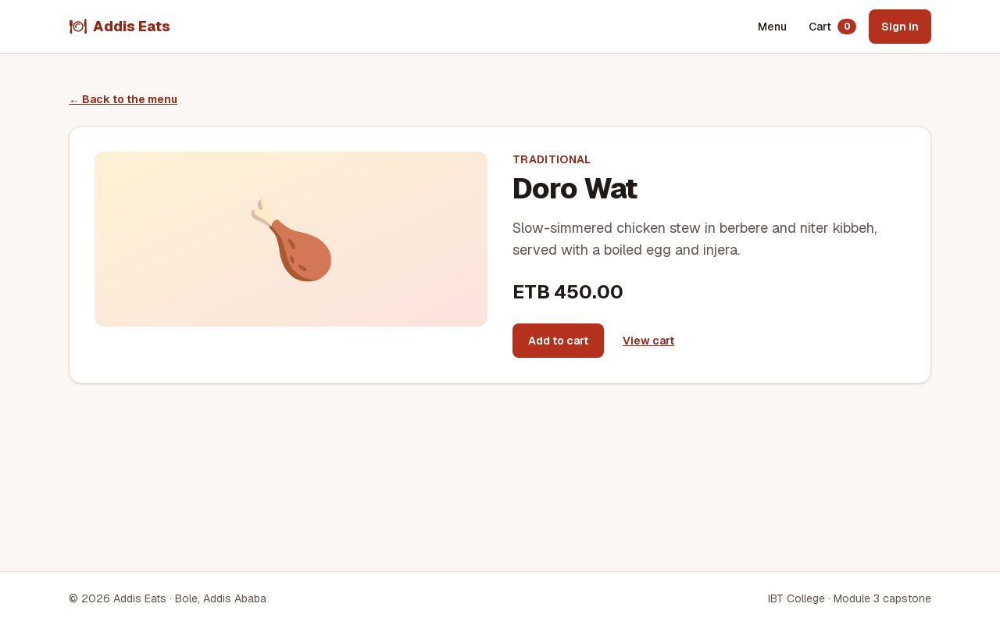
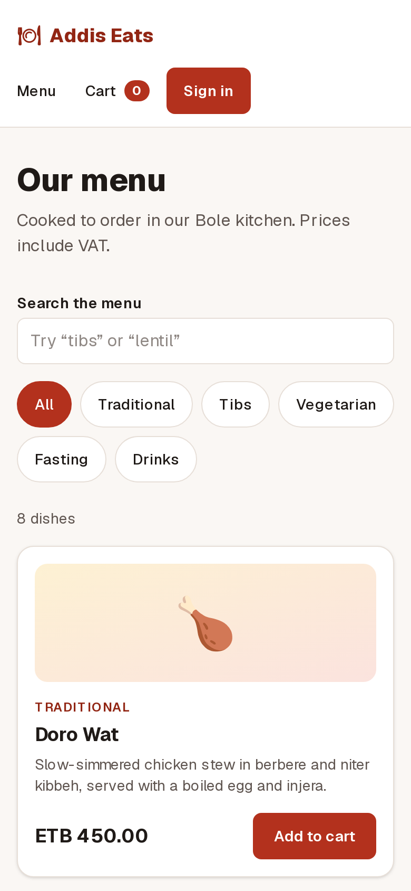
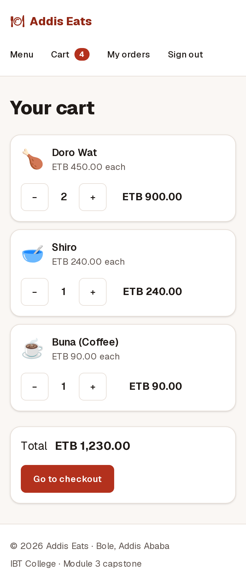
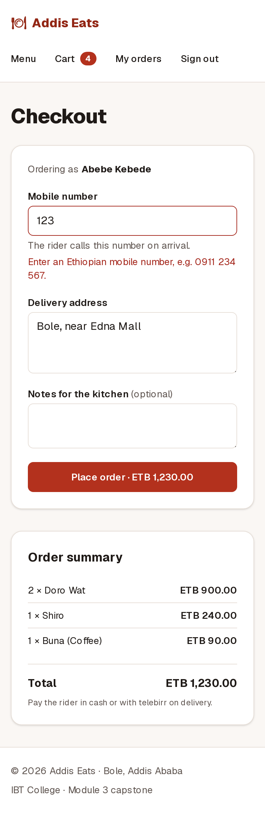
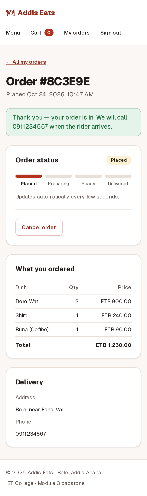
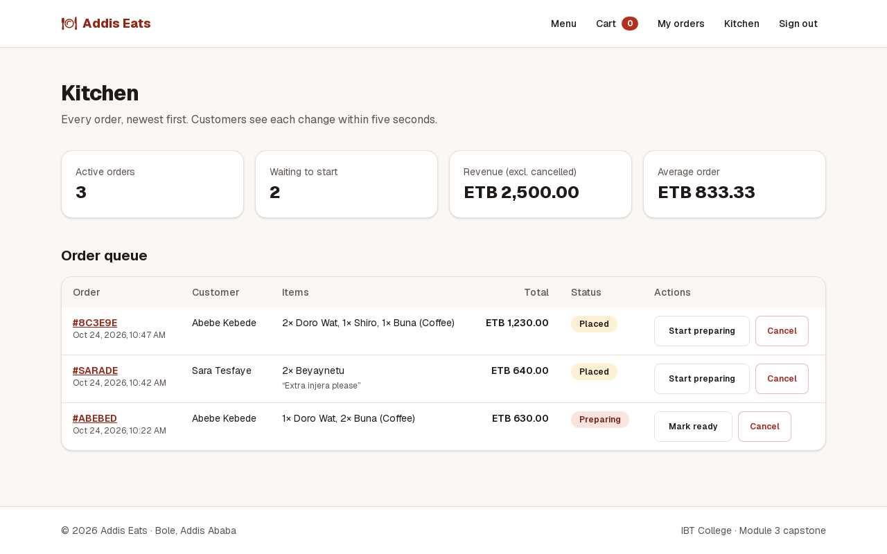
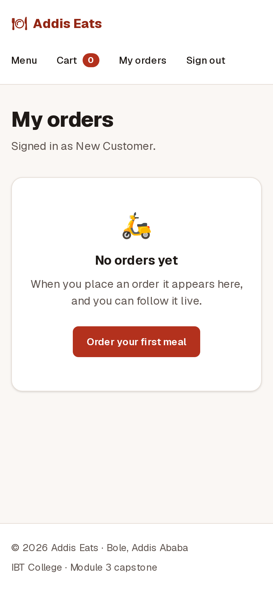

# Addis Eats

Order Ethiopian food in Addis Ababa and follow the delivery live. Customers browse the menu, fill a cart, check out with a phone number and a landmark, and watch the order move from **Placed → Preparing → Ready → Delivered**. Kitchen staff see every order on one dashboard and move it along.

Module 3 capstone · IBT College · Next.js 16 (App Router) · React 19 · Tailwind CSS 4

**Live URL:** _TODO — paste the Vercel production URL here after deploying (see below)_

## Try it

| Account | Email | Password |
| --- | --- | --- |
| Customer | `abebe@example.com` | `password123` |
| Second customer (for attack 2) | `sara@example.com` | `password123` |
| Kitchen staff | `kitchen@example.com` | `staffpass123` |

Or create a new account at `/signup`. The main flow: **Menu → Add to cart → Cart → Checkout → order page (live status)**. Then sign in as kitchen staff in a second window, press **Start preparing**, and watch the customer's page update within five seconds.

## Screenshots

Captured from the production build (`next build && next start`). Desktop is 1280 px wide; mobile is 390 px.

| Home | Dish page |
| --- | --- |
|  |  |

| Menu (mobile) | Cart (mobile) | Checkout validation (mobile) | Live order status (mobile) |
| --- | --- | --- | --- |
|  |  |  |  |

| Kitchen dashboard (staff) | Brand-new account: empty state |
| --- | --- |
|  |  |

## Run it from a fresh clone

Requires Node.js 20.9 or newer.

```bash
git clone <this repository>
cd DAY-49/addis-eats
npm install
cp .env.example .env.local      # then set SESSION_SECRET (command below)
npm run dev                     # http://localhost:3000
```

Generate a secret:

```bash
node -e "console.log(require('crypto').randomBytes(32).toString('base64url'))"
```

| Script | What it does |
| --- | --- |
| `npm run dev` | Development server |
| `npm run build` then `npm start` | Production build, served locally. Run it before every push: the build finds what the dev server forgives |
| `npm run lint` | ESLint (Next.js core-web-vitals rules) |
| `npm test` | Unit tests for the security-critical functions (redirects, session tokens, validation) |
| `npm run verify:attacks` | The Day 49 security battery against a running server (see [AUTH.md](AUTH.md)) |

## Environment variables

| Name | Required | Purpose |
| --- | --- | --- |
| `SESSION_SECRET` | **Yes, in production** (32+ chars) | Signs the session cookie. It is server-only, so it must never get the `NEXT_PUBLIC_` prefix. Without it, private pages refuse everyone (the app fails closed). |
| `NEXT_PUBLIC_SITE_URL` | Optional | The public origin, used for `metadataBase`, `og:image`, the sitemap and robots.txt. On Vercel it falls back to `VERCEL_PROJECT_PRODUCTION_URL`. It is inlined at build time and is public. |

## Deploy (Vercel)

1. Import the repository in Vercel and set **Root Directory** to `DAY-49/addis-eats`.
2. Add `SESSION_SECRET` (Production and Preview), and optionally `NEXT_PUBLIC_SITE_URL`.
3. Deploy, then run the battery against the live URL:
   `BASE_URL=https://<your-app>.vercel.app SESSION_SECRET=<same secret> npm run verify:attacks`
4. To roll back, promote the previous deployment in Vercel → Deployments → ⋯ → **Promote to Production**.

## How it is built

```
app/                 routes; each page is a Server Component unless it says "use client"
  actions/           Server Actions: auth.js (sign in/up/out), orders.js (place, cancel, advance)
  api/               Route Handlers: /api/session, /api/orders/[id] (polled by the status card)
  menu/ cart/ checkout/ orders/ kitchen/ signin/ signup/
components/          UI; Client Components only where there is a click, a hook or the browser
lib/
  auth/              pure, unit-tested: token.js (HMAC cookie), redirect.js, password.js, config.js
  db.js              data access, scoped by userId (in-memory store; see FUTURE.md)
  session.js         the only code that reads or writes the session cookie
  menu.js            the catalogue: the single source of names and prices
proxy.js             layer 1: early redirect for private routes (Next 16's name for middleware)
scripts/             verify-attacks.mjs
tests/               node --test unit tests
```

| Document | Covers |
| --- | --- |
| [AUTH.md](AUTH.md) | Every private route and action, its layers, the three attacks and the line that stops each |
| [DATA.md](DATA.md) | Every query: where it runs, its key, how it refreshes, and why |
| [PERF.md](PERF.md) | The performance budget, measured before and after |
| [FUTURE.md](FUTURE.md) | What was cut, and why |
| [PRESENTATION.md](PRESENTATION.md) | The eight-minute plan and the five files to have open |
